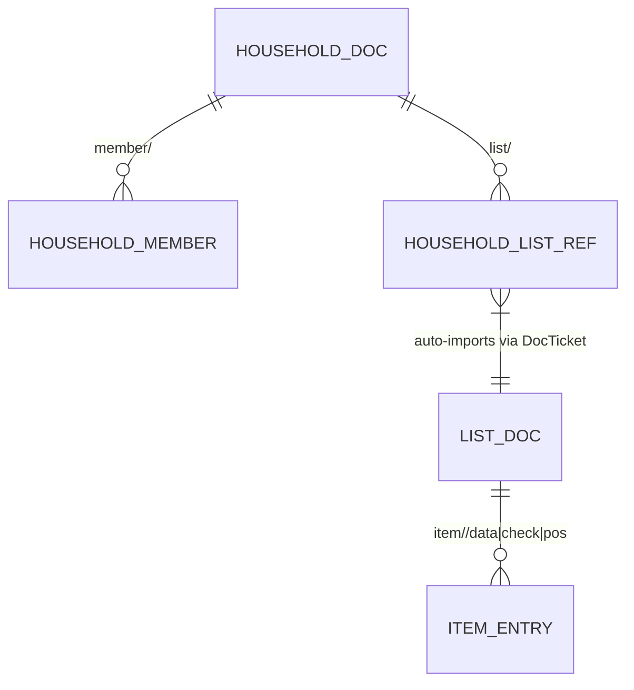

# Household & Multi-List Grouping Execution Plan

**Status:** Planned  
**Context:** [DESIGN.md](file:///C:/projects/groshe/DESIGN.md) §7 (Revocation & Rotation), §11 (Sharing Model: Per-List Now, Household Later), §16 (Revocation UX)  
**Target Branch:** `feature/household-grouping`  

---

## Executive Summary

Per [DESIGN.md](file:///C:/projects/groshe/DESIGN.md) §11, v1 shares individual lists one ticket at a time (sharing five lists requires scanning five tickets, and rotating a list requires manually re-sharing the new ticket with all remaining members). However, the v1 architecture baked in three forward-compatibility invariants specifically so the **Household Iteration** would be strictly additive rather than a destructive migration:
1. Globally unique UUIDv7 identifiers (`ListId`, `ItemId`, and `HouseholdId`).
2. Versioned `meta` schema on every document.
3. Membership and authorization abstracted in `crates/core` and `crates/sync`.

A **Household** is a separate, dedicated `iroh-docs` index document holding:
- Household metadata (`HouseholdMeta`: name, creator, creation timestamp, schema version).
- A shared member roster (`HouseholdMember`: author ID, display name, role/label, joined timestamp).
- References to member grocery lists (`HouseholdListRef`: namespace ID, current `DocTicket` string, title, active/archived flag, updated timestamp).

Joining a household via a single **Household Ticket** automatically imports and subscribes the peer to all current and future grocery lists registered in that household, and softens list rotation by updating the list reference inside the household index document automatically.

---

## Architecture & Data Model

### Household Document Key Layout (`crates/core`)
Values are CBOR-encoded structs stored in the household's `iroh-docs` namespace:
- `household/meta` -> `HouseholdMeta`
  - `id: HouseholdId` (UUIDv7)
  - `schema_version: u32` (`1`)
  - `name: String` (e.g., `"Smith Family Household"`)
  - `created_at: u64`
  - `created_by: String`
- `household/member/<author_id>` -> `HouseholdMember`
  - `author_id: String` (hex/base32 `AuthorId`)
  - `display_name: String` (e.g., `"Alice's Pixel"`, `"Home Server"`)
  - `joined_at: u64`
- `household/list/<namespace_id>` -> `HouseholdListRef`
  - `namespace_id: String`
  - `ticket: String` (serialized write `DocTicket` for auto-joining)
  - `title: String`
  - `added_at: u64`
  - `replaced_by: Option<String>` (populated when a list is rotated to point to the new `namespace_id`)

### Key Design Invariants
1. **Existing Per-List Documents Are Untouched:** Per [DESIGN.md](file:///C:/projects/groshe/DESIGN.md) §11, existing per-list documents are never merged or rewritten. A list can exist standalone *or* be published into a household index.
2. **Automatic List Discovery & Auto-Join:** When a peer opens or receives a `LiveEvent` on a household document, any active `HouseholdListRef` whose `namespace_id` is not yet in `node.list_ids()` is automatically imported via `node.import_list_str(&list_ref.ticket)`.
3. **Seamless List Rotation inside a Household:** When rotating a list that belongs to a household, the rotating node marks the old `HouseholdListRef` with `replaced_by = Some(new_ns_id)` and inserts the new `HouseholdListRef`. Connected household members automatically transition to the new namespace without manual QR re-scanning.

---

## Phased Execution Breakdown

### Phase 1: Core Domain & Projection Models (`crates/core` & `crates/store`)
**Goal:** Define pure-Rust household domain types, key schemas, validation, and materialized projection state.

- [ ] **1.1 Household Domain Types (`crates/core/src/household.rs`)**:
  - Define `HouseholdId(pub Uuid)` with `new_v7()`, `Display`, and `FromStr`.
  - Define `HouseholdMeta`, `HouseholdMember`, and `HouseholdListRef` with CBOR serialization (`to_cbor` / `from_cbor`) and non-empty name validation.
  - Define `HouseholdDocKey` enum:
    - `Meta` (`"household/meta"`)
    - `Member(String)` (`"household/member/<author_id>"`)
    - `ListRef(String)` (`"household/list/<namespace_id>"`)
- [ ] **1.2 Household Projection (`crates/store/src/household.rs`)**:
  - Implement `HouseholdProjection`:
    - `apply_entry(key_bytes, val_bytes, timestamp)` with LWW conflict resolution and tombstone handling (empty bytes remove a list ref or member).
    - `active_lists() -> Vec<&HouseholdListRef>` (filtering out tombstoned or rotated `replaced_by.is_some()` entries).
    - `members() -> Vec<&HouseholdMember>`.
- [ ] **1.3 Unit Tests**:
  - Roundtrip CBOR and key parsing tests in `crates/core`.
  - Multi-entry LWW projection and rotation replacement tests in `crates/store`.

---

### Phase 2: Sync Engine & Auto-Subscription (`crates/sync`)
**Goal:** Enable `GrosheSyncNode` to create, join, sync, and auto-import member lists from household documents.

- [ ] **2.1 Household Lifecycle Methods on `GrosheSyncNode` (`crates/sync/src/lib.rs`)**:
  - Track known household namespace IDs in a local registry file (`households.json` in `storage_dir`) so household docs are distinguished from grocery list docs.
  - `create_household(name: &str, member_name: &str) -> Result<(Doc, DocTicket, NamespaceId), SyncError>`:
    - Creates a new `iroh-docs` namespace, writes `HouseholdMeta` and the creator's `HouseholdMember` entry, and records the namespace in `households.json`.
  - `join_household(ticket_str: &str, member_name: &str) -> Result<(Doc, NamespaceId), SyncError>`:
    - Imports the household doc ticket, writes the joining peer's `HouseholdMember` entry, and runs `reconcile_household_lists(&doc)`.
  - `publish_list_to_household(household_doc: &Doc, list_doc: &Doc, title: &str) -> Result<(), SyncError>`:
    - Generates a write `DocTicket` for `list_doc` and writes `HouseholdListRef` at `household/list/<ns_id>`.
  - `reconcile_household_lists(household_doc: &Doc) -> Result<Vec<NamespaceId>, SyncError>`:
    - Loads `HouseholdProjection` from `household_doc`.
    - For each active `HouseholdListRef`, if not already present locally, imports `list_ref.ticket` and opens the list replica.
    - If a list ref has `replaced_by: Some(new_ns)`, drops the old list replica once the replacement is imported.
- [ ] **2.2 Multi-Peer Household Convergence Test (`crates/sync/tests/`)**:
  - Verify Peer A creates a household and publishes 3 grocery lists; Peer B joins with the single household ticket and automatically converges on all 3 grocery lists.
  - Verify Peer A adds a 4th list later; Peer B auto-discovers and syncs the 4th list via the household doc.

---

### Phase 3: CLI, Web Companion & Mobile Surfaces (`crates/cli`, `apps/web`, `apps/android`)
**Goal:** Expose household creation, joining, roster viewing, and automatic list linking across all user surfaces.

- [ ] **3.1 CLI Subcommands (`crates/cli/src/args.rs` & `main.rs`)**:
  - Add `grocery household` subcommand group:
    - `grocery household create <name> [--member-name <name>]`
    - `grocery household join <ticket> [--member-name <name>]`
    - `grocery household share [--household <id>]`
    - `grocery household add-list <list_id> [--household <id>]`
    - `grocery household ls` (shows household name, member roster, and linked lists)
- [ ] **3.2 Web Companion Household Endpoints & UI (`apps/web`)**:
  - Add `GET /api/households`, `POST /api/households` (create), `POST /api/households/join`, and `POST /api/households/:id/lists` (publish list).
  - Add a Household selector / badge in the Web Companion header showing the active household name, member count, and a button to copy the household invite ticket.
- [ ] **3.3 Mobile Slint UI & Sync Bridge (`apps/android`)**:
  - Add Household status and Join/Share Household controls in `share_join_screen.slint` and `sync_bridge.rs`.
  - When a new list is created on mobile while a household is active, automatically publish the list reference to the active household.

---

## Commit & Quality Gate Strategy
- **Branch:** `feature/household-grouping`
- **Granular Commits (~300 lines target per [AGENTS.md](file:///C:/projects/groshe/AGENTS.md)):**
  1. `feat(core,store): add household domain types, key schema, and projection`
  2. `feat(sync): implement household doc lifecycle and auto-list reconciliation`
  3. `feat(cli,web,android): add household commands, REST API, and UI integration`
