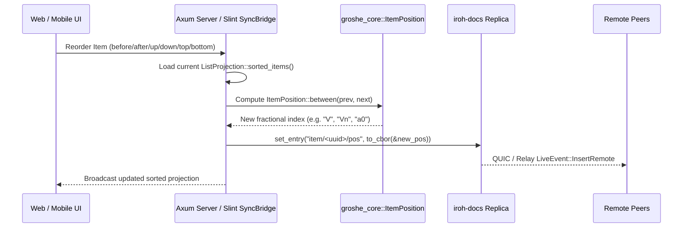

# Item Reordering & Drag-to-Reorder Execution Plan

**Status:** Planned  
**Context:** [DESIGN.md](file:///C:/projects/groshe/DESIGN.md) §6.2 (`item/<uuidv7>/pos`), §6.3 (Ordering semantics), §8 (CLI `pos`), §10 (Mobile List Detail reorder), §9 (Web Companion)  
**Target Branch:** `feature/item-reordering`  

---

## Executive Summary

Per [DESIGN.md](file:///C:/projects/groshe/DESIGN.md) §6.2, each item manual sort order is stored in a dedicated CRDT key (`item/<uuidv7>/pos`) containing a conflict-free fractional-index string (`ItemPosition`). Splitting `pos` from `data` and `check` ensures that reordering an item never clobbers concurrent quantity edits or check-offs.

While `crates/core` (`ItemPosition::before`, `after`, `between`), `crates/store` (`ListProjection::sorted_items()`), and `crates/cli` (`grocery pos --before/--after/--top/--bottom`) already implement fractional positioning, the **Web Companion (`apps/web`)** and **Mobile Slint App (`apps/android`)** currently only append items and lack UI controls and handlers to reorder existing items.

This plan delivers end-to-end item reordering across the Web Companion (HTML5 drag-and-drop + accessible Up/Down controls + REST endpoint), Mobile Slint UI (one-handed Up/Down reorder buttons & sync bridge handler), and cross-surface E2E convergence tests.

---

## Architecture & Fractional Indexing Semantics

### Key Design Invariants
1. **Zero Clobbering of Item Data or Checked State:** Reordering only writes to `DocKey::item_pos(item_id)`. `DocKey::item_data` and `DocKey::item_check` are untouched.
2. **Checked vs. Unchecked Grouping Preservation:** `ListProjection::sorted_items()` sorts by `(is_checked(), &item.position, &item.id)`. Reordering operates within the item active group (unchecked items reorder relative to unchecked neighbors; checked items relative to checked neighbors) or across the full sorted projection when explicit `before_id`/`after_id` targets are given.
3. **One-Handed Mobile Operability & Accessibility:** Per [DESIGN.md](file:///C:/projects/groshe/DESIGN.md) §10, every item row must be operable one-handed with TalkBack/VoiceOver accessibility labels. In addition to HTML5 drag-and-drop on Web, both Web and Mobile provide explicit Up (`↑`) and Down (`↓`) reorder actions.

---

## Phased Execution Breakdown

### Phase 1: Web Companion Reorder API & Drag-and-Drop UI (`apps/web`)
**Goal:** Enable reordering items via REST API, HTML5 drag-and-drop, and accessible Up/Down buttons in the Web Companion.

- [ ] **1.1 `ReorderItemRequest` DTO (`apps/web/src/api.rs`)**:
  - Define `ReorderItemRequest` with:
    - `before_id: Option<String>` (place item immediately before this item ID)
    - `after_id: Option<String>` (place item immediately after this item ID)
    - `direction: Option<String>` (`"up"`, `"down"`, `"top"`, or `"bottom"`)
- [ ] **1.2 REST Endpoint `POST /api/lists/:id/pos/:item_id` (`apps/web/src/server.rs`)**:
  - Register `.route("/api/lists/:id/pos/:item_id", post(reorder_item))` in `create_router`.
  - Implement `reorder_item`:
    - Load `ListProjection` and locate the target `item_id` in `proj.sorted_items()`.
    - Compute the new `ItemPosition`:
      - `direction == "top"`: `ItemPosition::before(&first.position)`
      - `direction == "bottom"`: `ItemPosition::after(&last.position)`
      - `direction == "up"`: find the previous neighbor in the same checked-group (`idx - 1`) and compute `ItemPosition::between(group.get(idx - 2).map(|i| &i.position), Some(&group[idx - 1].position))`.
      - `direction == "down"`: find the next neighbor in the same checked-group (`idx + 1`) and compute `ItemPosition::between(Some(&group[idx + 1].position), group.get(idx + 2).map(|i| &i.position))`.
      - `before_id`: locate target item `T` in `sorted_items` (excluding `item_id`), compute `ItemPosition::between(prev.map(|i| &i.position), Some(&T.position))`.
      - `after_id`: locate target item `T` in `sorted_items` (excluding `item_id`), compute `ItemPosition::between(Some(&T.position), next.map(|i| &i.position))`.
    - Persist via `state.node.set_entry(&doc, DocKey::item_pos(item_id).to_key_bytes(), to_cbor(&new_pos)?)`.
    - Return updated `Json<ItemDto>` with the new `position` string.
- [ ] **1.3 Web Companion UI (`apps/web/src/frontend.rs`)**:
  - Add a drag handle (`⠿`) and compact Up/Down (`↑` / `↓`) reorder buttons in `.item-actions`.
  - Add HTML5 Drag-and-Drop handlers (`draggable="true"`, `ondragstart`, `ondragover`, `ondrop`) on `.item-row` elements so desktop/tablet users can drag items directly into place (calling `POST /api/lists/${activeListId}/pos/${draggedId}` with `{ before_id: targetId }` or `{ after_id: targetId }`).
  - Wire Up/Down buttons to `moveItem(itemId, "up" | "down")` for accessible keyboard and mobile touch reordering.
- [ ] **1.4 Web Integration Tests (`apps/web/tests/api_integration_tests.rs`)**:
  - Extend or add an integration test verifying `POST /api/lists/:id/pos/:item_id` with `direction: "up"`, `direction: "top"`, and `before_id`, asserting that `GET /api/lists/:id` returns items in the newly ordered sequence.

---

### Phase 2: Mobile Slint UI & Sync Bridge Reordering (`apps/android`)
**Goal:** Add one-handed item reordering to the Slint Detail Screen and wire it through `GrosheSyncNode`.

- [ ] **2.1 Slint Detail Screen UI (`apps/android/ui/detail_screen.slint`)**:
  - Add `callback move_item_up(string /* id */);` and `callback move_item_down(string /* id */);` to `DetailScreen`.
  - Add compact Up (`↑`) and Down (`↓`) touch buttons with accessible labels (`"Move " + item.name + " up"`, `"Move " + item.name + " down"`) in the item card action bar alongside Edit (`✎`) and Delete (`✕`).
- [ ] **2.2 Slint App Window Routing (`apps/android/ui/app.slint` & `apps/android/src/lib.rs`)**:
  - Expose `callback move_item_up(string);` and `callback move_item_down(string);` on `AppWindow` and forward from `DetailScreen`.
  - In `setup_app_window` (`apps/android/src/lib.rs`), wire `on_move_item_up` and `on_move_item_down` to dispatch `SyncCommand::MoveItem { id, direction }`.
- [ ] **2.3 Sync Bridge Handler (`apps/android/src/sync_bridge.rs`)**:
  - Add `MoveDirection { Up, Down }` and `SyncCommand::MoveItem { id: String, direction: MoveDirection }`.
  - In the `spawn_sync_bridge` event loop:
    - Resolve `ItemId` and inspect `current_proj.sorted_items()`.
    - Filter neighbours within the same checked state group so moving an unchecked item up/down swaps its relative position with the adjacent unchecked item.
    - Calculate the new `ItemPosition` via `ItemPosition::between(...)`.
    - Write `DocKey::item_pos(item_id)` to `active_doc` via `node.set_entry`.
    - Reload `current_proj` and push updated `ModelRc` items to the Slint UI.

---

### Phase 3: Cross-Surface E2E Reordering Convergence & Verification (`crates/sync`)
**Goal:** Prove that item reordering across Web, Mobile, and CLI converges identically across all peers without clobbering concurrent edits or checks.

- [ ] **3.1 Cross-Surface Reorder E2E Test (`crates/sync/tests/e2e_cross_surface_stress.rs`)**:
  - Add `test_cross_surface_item_reorder_convergence`:
    1. Create 3 items (`"Apples"`, `"Bananas"`, `"Carrots"`) on Peer A (Web Companion).
    2. Wait for Peer B (Mobile) to converge on `[Apples, Bananas, Carrots]`.
    3. Reorder `"Carrots"` to the top via Web Companion `POST /api/lists/:id/pos/:carrot_id` (`direction: "top"`).
    4. Verify Peer B converges on `[Carrots, Apples, Bananas]`.
    5. Concurrently on Peer B, move `"Bananas"` between `"Carrots"` and `"Apples"` via `DocKey::item_pos` while Peer A checks off `"Apples"`.
    6. Verify both peers converge on the exact same fractional position ordering and check state without data loss.
- [ ] **3.2 Workspace Quality Gate**:
  - `cargo test --workspace` (100% pass rate).
  - `cargo clippy --workspace --all-targets -- -D warnings` (zero warnings).

---

## Commit & Branch Strategy
- **Branch:** `feature/item-reordering`
- **Granular Commits (~300 lines target per [AGENTS.md](file:///C:/projects/groshe/AGENTS.md)):**
  1. `docs(plan): add item reordering and drag-to-reorder execution plan`
  2. `feat(web): add item reorder REST endpoint and drag-and-drop UI`
  3. `feat(android,sync): add mobile item reordering and cross-surface E2E convergence test`
