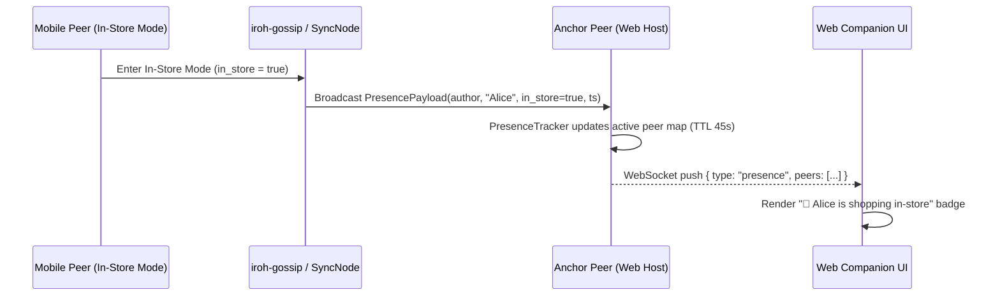

# Live Peer Presence & In-Store Activity Indicators Execution Plan

**Status:** Planned  
**Context:** [DESIGN.md](file:///C:/projects/groshe/DESIGN.md) §5 (Sync Design: Presence via `iroh-gossip`), §8 (CLI `peers`), §10 (Mobile UI: peer/sync status & in-store mode)  
**Target Branch:** `feature/live-peer-presence`  

---

## Executive Summary

Per [DESIGN.md](file:///C:/projects/groshe/DESIGN.md) §5:
> *Presence: gossip topic derived from the list's namespace. Used for "who else is online / in-store" and live change fan-out; correctness never depends on gossip — docs set reconciliation is the source of convergence.*

Currently, `crates/sync/src/presence.rs` defines `derive_presence_topic(&NamespaceId)` and `PresencePayload` (`author_id`, `author_name`, `in_store: bool`, `timestamp`), and `GrosheSyncNode` initializes an `iroh_gossip::net::Gossip` actor. However, live presence heartbeats are not yet actively broadcast or tracked in a peer presence registry, nor surfaced in the Web Companion or Mobile Slint UI.

This plan completes the end-to-end **Live Peer Presence** system:
1. A reactive `PresenceTracker` in `crates/sync` that broadcasts periodic `PresencePayload` heartbeats over `iroh-gossip` (and optional doc-level ephemeral presence fallback for relay-only web sessions) and prunes stale peers after a configurable TTL (e.g., 45 seconds).
2. Live "Who's Online / Shopping In-Store" indicators in the **Web Companion** (`apps/web`) via REST & WebSocket push.
3. Live peer count and `🛒 N shopping in-store` badges in the **Mobile Slint UI** (`apps/android` Lists, Detail, and In-Store screens), automatically toggling `in_store = true` when the user enters In-Store Shopping Mode.

---

## Architecture & Presence Flow

### Key Design Invariants
1. **Correctness Never Depends on Gossip:** If gossip packets drop or a peer disconnects ungracefully, list state convergence is unaffected (`iroh-docs` handles all data). Presence entries expire cleanly after `PRESENCE_TTL_SECS = 45`.
2. **Automatic In-Store Status Transition:** Entering In-Store Mode (`active_tab == 2` on Mobile or toggling In-Store view on Web) immediately broadcasts `in_store: true`. Exiting In-Store Mode broadcasts `in_store: false`.
3. **Zero UI Blocking:** All gossip subscriptions and heartbeat timers run asynchronously inside the background Tokio runtime (`GrosheSyncNode` / `sync_bridge`), pushing lightweight snapshots to the UI.

---

## Phased Execution Breakdown

### Phase 1: Presence Tracker & Gossip Heartbeat Engine (`crates/sync`)
**Goal:** Manage per-list active peer presence state with TTL expiration and gossip broadcasting.

- [ ] **1.1 `PresenceTracker` & `PeerPresenceInfo` (`crates/sync/src/presence.rs`)**:
  - Define `PRESENCE_TTL_SECS: u64 = 45` and `HEARTBEAT_INTERVAL_SECS: u64 = 15`.
  - Define `PeerPresenceInfo`:
    - `author_id: String`
    - `author_name: String`
    - `in_store: bool`
    - `last_seen: u64`
  - Implement `PresenceTracker`:
    - `record_heartbeat(payload: PresencePayload)`
    - `active_peers(list_id: &NamespaceId, now: u64) -> Vec<PeerPresenceInfo>` (prunes entries where `now.saturating_sub(last_seen) > PRESENCE_TTL_SECS`).
    - `in_store_count(list_id: &NamespaceId, now: u64) -> usize`.
- [ ] **1.2 `GrosheSyncNode` Presence Integration (`crates/sync/src/lib.rs`)**:
  - Embed `Arc<RwLock<PresenceTracker>>` in `GrosheSyncNode`.
  - Add `announce_presence(&self, doc: &Doc, author_name: &str, in_store: bool) -> Result<(), SyncError>`:
    - Broadcasts `PresencePayload` over the list's `iroh-gossip` topic and records locally in `PresenceTracker`.
  - Add `active_peers(&self, ns_id: &NamespaceId) -> Vec<PeerPresenceInfo>` querying non-expired peers.
- [ ] **1.3 Unit & Integration Tests (`crates/sync`)**:
  - Unit tests in `crates/sync/src/presence.rs` verifying heartbeat registration, `in_store` toggling, and 45-second TTL expiration.

---

### Phase 2: Web Companion Live Presence API & UI Badges (`apps/web`)
**Goal:** Surface active peers and in-store shoppers in real time in the Web Companion.

- [ ] **2.1 Presence DTOs (`apps/web/src/api.rs`)**:
  - Add `PeerPresenceDto { author_id: String, author_name: String, in_store: bool, last_seen: u64 }`.
  - Add `UpdatePresenceRequest { author_name: Option<String>, in_store: bool }`.
  - Include `active_peers: Vec<PeerPresenceDto>` in `ListDetailDto`.
- [ ] **2.2 REST Endpoint & WebSocket Broadcast (`apps/web/src/server.rs`)**:
  - Add `POST /api/lists/:id/presence` allowing the web client or peer to announce its presence (`in_store: true/false`) and return the updated `Vec<PeerPresenceDto>`.
  - Include `active_peers` in `GET /api/lists/:id` and WebSocket `initial` / `update` snapshots.
- [ ] **2.3 Web Companion UI (`apps/web/src/frontend.rs`)**:
  - Add an **In-Store Shopping Mode** toggle button (`🛒 In-Store Mode`) in the Web Companion toolbar that enlarges touch targets, collapses checked items, and posts `{ in_store: true }` to `/api/lists/${activeListId}/presence`.
  - Render live presence pills in the header/sub-bar showing connected peers and highlighting shoppers currently in-store (e.g., `🟢 2 online · 🛒 Alice in-store`).
- [ ] **2.4 Web Integration Test (`apps/web/tests/api_integration_tests.rs`)**:
  - Add `test_web_presence_announcement_and_query` verifying `POST /api/lists/:id/presence` and verifying `GET /api/lists/:id` reflects active peers and `in_store` status.

---

### Phase 3: Mobile Slint UI Presence & In-Store Broadcast (`apps/android`)
**Goal:** Automatically broadcast `in_store` status when entering/exiting In-Store Mode on Mobile and display live peer indicators.

- [ ] **3.1 Slint Presence Properties & Callbacks (`apps/android/ui/app.slint`, `lists_screen.slint`, `in_store_screen.slint`)**:
  - Add `in-out property <string> active_presence_summary: "1 online";` to `AppWindow`.
  - Add `callback set_in_store_mode(bool /* in_store */);` triggered when switching to/from Tab 2 (`InStoreScreen`).
  - Display `active_presence_summary` badge in the top app bar and inside `InStoreScreen` banner.
- [ ] **3.2 Sync Bridge Presence Heartbeat (`apps/android/src/sync_bridge.rs` & `lib.rs`)**:
  - Add `SyncCommand::SetInStoreMode { in_store: bool }`.
  - Add a periodic 15-second `tokio::time::interval` branch in `spawn_sync_bridge` that broadcasts the local peer's `PresencePayload` for `active_doc` and updates `app.set_peer_count(...)` and `app.set_active_presence_summary(...)`.
- [ ] **3.3 Cross-Surface Verification**:
  - `cargo test --workspace` (100% pass rate).
  - `cargo clippy --workspace --all-targets -- -D warnings` (zero warnings).

---

## Commit & Quality Gate Strategy
- **Branch:** `feature/live-peer-presence`
- **Granular Commits (~300 lines target per [AGENTS.md](file:///C:/projects/groshe/AGENTS.md)):**
  1. `feat(sync): implement PresenceTracker with TTL expiration and node announce API`
  2. `feat(web): add presence REST endpoint, WebSocket push, and in-store UI toggle`
  3. `feat(android): wire mobile in-store presence broadcasting and status badges`
